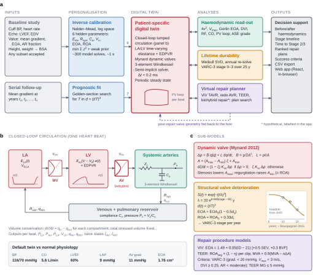

# Biohybrid Heart Valve Digital Twin

**Live app:** https://datascintist-abusufian.github.io/biohybrid-heart-valve/



**Figure 1 | Biohybrid heart valve digital twin.** **a**, Data flow from routine echo and cuff measurements through inverse calibration to the patient-specific twin and its three analyses (haemodynamic read-out, lifetime durability, virtual repair planning). **b**, Closed-loop lumped-parameter circulation with dynamic (Mynard) valves, solved every 0.2 ms to periodic steady state. **c**, Sub-models for valve dynamics, structural valve deterioration (calibrated to Bourguignon 2015) and repair procedures. *Hypothetical biohybrid repair is labelled in the app.

A physics-based digital twin of a biohybrid (bioprosthetic) aortic heart valve. It runs entirely in the browser. Every number comes from solving a published cardiovascular model, not from random or placeholder data.

> Research and teaching simulation. Not a medical device and not for clinical decisions. The self-repair and AI-triggered repair behaviour of biohybrid valves is hypothetical and labelled as such in the app.

## What it does

| Tab | Content |
|---|---|
| **Live haemodynamics** | Closed-loop left-heart and circulation model, solved every 0.2 ms. Shows animated pressure and flow waveforms, the LV pressure–volume loop and en-face valve motion. Read-outs: BP, CO, EF, mean/peak gradient, Vmax, Gorlin EOA, DVI, regurgitant fractions, LA pressure, stroke work. Clinical grading follows ASE 2009 prosthetic-valve criteria, regurgitant-fraction severity and patient–prosthesis mismatch (iEOA). Six scenarios are included, such as PPM, calcific SVD, leaflet tear and low-flow low-gradient. |
| **Lifetime & durability** | Structural valve deterioration over 25 years. Each annual echo is re-simulated by the twin and VARC-3 stages are assigned automatically. The cohort freedom-from-SVD curve is calibrated to published durability data. Hypothetical levers model biohybrid self-repair and an AI-triggered repair policy. |
| **Valve repair planner** | Virtual repair on the patient's twin, before and after. For the failed biohybrid aortic valve: valve-in-valve TAVR (balloon- or self-expanding, optional valve fracture, by surgical-valve true internal diameter), redo surgical AVR, and a hypothetical biohybrid in-situ repair. For the mitral valve: transcatheter edge-to-edge repair (TEER) with clip number, width and position per segment. Results are judged against VARC-3 valve-performance or TEER targets (residual MR, mean gradient ≤ 5 mmHg, forward flow). A model-based plan search simulates every candidate plan and ranks them. |
| **Personalise (inverse model)** | Nelder–Mead calibration of six hidden parameters (contractility, resistance, compliance, blood volume, EOA, regurgitant orifice) from routine echo and cuff values. A second step fits serial follow-up gradients to give a personal forecast of when VARC-3 Stage 2 and Stage 3 would be reached. |
| **Methods & references** | Equations, a validation table against normal physiology, limitations and references. |

## Model

- **Heart chambers:** time-varying elastance with double-Hill activation (Stergiopulos 1996) and an exponential EDPVR.
- **Arterial load:** 3-element Windkessel (Westerhof 2009). The venous and pulmonary compartments are lumped into one reservoir.
- **Valves:** Mynard et al. 2012, where Δp = B·q|q| + L·dq/dt and valve opening is driven by the pressure difference (no ideal diodes).
- **Durability:** Weibull law (shape 3) with an age-dependent scale, calibrated to Bourguignon 2015 and Johnston 2015 (freedom from reoperation for SVD). Damage narrows the orifice (stenosis) and/or opens a regurgitant gap.
- **Repair calibration:** valve-in-valve gradients match registry averages (VIVID ~16 mmHg; REDUCE regression for valve size, valve type and fracture). TEER mitral gradients match reported post-MitraClip values, and > 5 mmHg is flagged (Oguz 2021).
- **Clinical definitions:** ASE 2009 (Zoghbi) prosthetic valve criteria and VARC-3 (2021) bioprosthetic valve deterioration stages.

The source is in `src/twin/`:

- `model.ts`: ODE model, beat analysis, clinical classification
- `lifetime.ts`: SVD and durability model, VARC-3 surveillance
- `fit.ts`: inverse calibration and prognosis
- `repair.ts`: procedure models, success criteria and the plan search
- `charts.tsx`: lightweight animated SVG plots and the valve graphic

## Run locally

```bash
npm ci
npm run dev      # http://localhost:5173/biohybrid-heart-valve/
npm run build
```

Pushing to `main` triggers a GitHub Actions deploy to GitHub Pages (`.github/workflows/deploy.yml`).

## Limitations

The model has no right heart, coronary circulation, baroreflex or LV remodelling. The durability calibration uses data from one surgical bioprosthesis family. Simulated gradients are noise-free. No clinical data yet exist for self-repairing biohybrid valves or nanorobotic valve repair.

© Md Abu Sufian · MIT License
